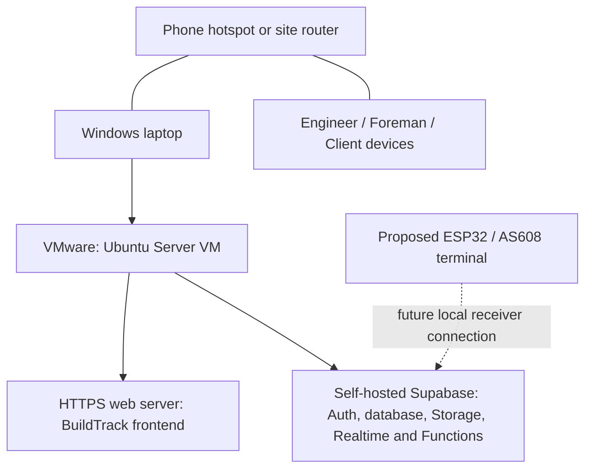

# BuildTrack local server implementation guide

Prepared: October 23, 2026

Status: proposed deployment procedure, not an implemented or tested deployment

## 1. What this setup means

Yes, a Windows laptop can run VMware with an Ubuntu Server virtual machine that serves BuildTrack to devices on the same hotspot or router. The local network can remain usable without internet if the selected hotspot permits it. The application, authentication, database, files and required backend functions must all run locally.

This is **operation over a local network without internet**. Users still need a connection to the server. Operation while a phone is disconnected from both the internet and the site network is a different requirement, supported only by BuildTrack's existing selected offline submissions until further development is completed.



The Windows laptop remains the host. Ubuntu runs inside VMware. Windows Server is an alternative guest, but adds complexity for this Linux-container backend. This guide uses Ubuntu directly in VMware.

## 2. Current BuildTrack facts and implementation gates

The inspected application uses React/TypeScript/Vite and Supabase. `src/lib/supabase.ts` reads `VITE_SUPABASE_URL` and `VITE_SUPABASE_ANON_KEY` at build time. The project also depends on database functions, permissions, private buckets, authentication and server functions. A static copy of the website is therefore insufficient.

Existing login includes email/password; Google login and email verification also exist. Admin actions enforce authenticator TOTP assurance level `aal2`. The local deployment must retain these authorization rules. Google login and external email remain internet-dependent. Prepare local test accounts before disconnecting; do not remove MFA or permission checks to make the demonstration work.

The functions currently present are `admin-users`, `impersonate`, `oauth-gate`, `biometric-attendance`, `biometric-enrollment` and `send-notifications`, with shared helpers. Biometric hardware is not physically connected or validated. The local deployment and cloud/local synchronization have not been implemented.

**Developer gate:** deployment compatibility, local account provisioning, server-function imports, storage URLs and authentication must be verified on an isolated instance. Where a gate fails, record the gap and make a separately reviewed implementation change. This guide itself changes no application code or database.

## 3. Prepare equipment and record the plan

1. Use the Windows laptop as the server host, with its charger connected and sleep disabled during the session.
2. Install VMware Workstation and obtain a supported Ubuntu Server ISO from the official vendors. Ubuntu Server 24.04 LTS is one supported choice for Docker Engine; check support again when installing.
3. Use a phone hotspot for a small trial, or a dedicated router for a more repeatable network. Confirm that connected devices can reach each other and that the network stays active with internet/mobile data disabled. A hotspot that isolates clients is unsuitable without a different network arrangement.
4. Prepare at least one separate phone or laptop as a client. Do not count access from the host laptop alone as a multi-device test.
5. Allocate VM resources after checking the host's available capacity. At preparation time, Supabase documents a full-stack minimum of 2 CPU cores, 4 GB RAM and 40 GB SSD; the host OS also needs resources. These are vendor requirements, not a measured BuildTrack capacity result.
6. Record the host, VM resources, software versions, BuildTrack commit, network device and test client. Leave unknowns blank until checked.
7. Complete installation, package downloads, container pulls and test-data preparation while internet is available.

References: [Docker on Ubuntu](https://docs.docker.com/engine/install/ubuntu/) and [Supabase self-hosting prerequisites](https://supabase.com/docs/guides/self-hosting/docker).

## 4. Create and connect the VM

1. In VMware, create a new VM and install Ubuntu Server. Use a distinct administrator account for the VM.
2. Connect the Windows host and test client to the same hotspot/router.
3. Set the VM network adapter to **Bridged** and bind it to the host's actual connected Wi-Fi or Ethernet adapter. Enable connection at power-on. Do not assume automatic bridging chose the right adapter.
4. Start Ubuntu and run these inspection commands **inside the VM**:

   ```bash
   ip -br address
   ip route
   ```

5. Identify the VM's LAN address. The address `192.168.43.50` used below is an example only. Substitute the address actually assigned to the VM everywhere in the guide.
6. On a router, reserve that address for the VM if supported. With a phone hotspot, recheck the address after every restart. An address change also affects certificates, API URLs, QR links and the frontend build.
7. Check that the host can reach the VM. On Windows, `Test-NetConnection <VM_IP> -Port 443` becomes useful once HTTPS is running. A failed ping alone is not proof that all application traffic is blocked.
8. If the VM cannot obtain a usable address or other clients cannot reach it, resolve bridging/client isolation before installing the application. A router or wired adapter may be needed. NAT with explicit port forwarding is an alternative, but requires a different address/port plan. Host-only networking does not directly connect ordinary Wi-Fi clients to the VM.

Reference: [VMware network modes](https://knowledge.broadcom.com/external/article?legacyId=1006480).

## 5. Prepare Ubuntu and Docker

Run the following only in the new Ubuntu VM, not in the shared Windows development checkout:

```bash
sudo apt update
sudo apt install ca-certificates curl git
```

1. Follow Docker's official Ubuntu repository installation steps and install Docker Engine plus the Compose plugin. Avoid mixing distribution Docker packages with the vendor packages.
2. Confirm installation:

   ```bash
   sudo docker version
   sudo docker compose version
   sudo docker run --rm hello-world
   ```

3. Keep the VM's clock correct. Authenticator codes and session checks depend on time; verify them again after disconnecting from internet time services.
4. Download the application dependencies and every required container image before the internet-disconnected test.

The commands above verify tooling only. They do not deploy BuildTrack. Follow [Docker's installation instructions](https://docs.docker.com/engine/install/ubuntu/) for the current package/repository details.

## 6. Install a separate self-hosted Supabase instance

1. Follow the official [Docker self-hosting guide](https://supabase.com/docs/guides/self-hosting/docker), using its manual installation route and a reviewed, pinned self-hosted release. Record the release tag and image versions.
2. Put the stack in a separate VM directory, for example `/opt/buildtrack-lab/backend`. It must not point to or overwrite the managed/cloud database.
3. Configure unique local credentials privately using the vendor's generation/configuration process. Do not copy production secrets into the frontend or publish configuration values. Only the local anonymous/public client key belongs in a browser build; service-role keys stay server-side.
4. Keep persistent database and file volumes outside disposable container layers. Configure restart behavior, disk capacity and shutdown procedures.
5. Use the release's documented startup command. For a release with the supplied wrapper, this is `sudo sh run.sh start` from its stack directory. Then inspect service status with `sudo docker compose ps`. Do not assume another release uses identical commands or service names.
6. Retain the services BuildTrack needs: Auth, PostgreSQL/API, private Storage, Realtime and Functions. A plain PostgreSQL installation does not provide all of these.
7. Restrict database/admin interfaces to the administrator. Publish only the intended application/API endpoints to the local client network. Review Docker port bindings: Docker-published ports can bypass UFW rules, so UFW alone is insufficient.

Do not expose the Supabase CLI development stack as the operational site server. Use the self-hosted deployment configuration and verify the selected release before proceeding.

## 7. Set up local HTTPS and application addresses

Use this proposed address plan, replacing the example IP consistently:

| Purpose | Example client address |
|---|---|
| BuildTrack website | `https://192.168.43.50` |
| Local Supabase API | `https://192.168.43.50:8443` |
| Backend gateway, VM-internal access | `http://127.0.0.1:8000`, if the chosen release uses that gateway port |

1. Install Caddy following its [official Ubuntu instructions](https://caddyserver.com/docs/install).
2. Use a local certificate authority and explicitly trust its root certificate on every test client. Distribute only the public root certificate, never the CA private key. Follow each client platform's certificate-trust procedure.
3. The following is an illustrative Caddy configuration for a proxy installed directly on the VM. Confirm the actual gateway bind and frontend directory before using it:

   ```caddyfile
   https://192.168.43.50 {
       tls internal
       root * /srv/buildtrack
       try_files {path} /index.html
       file_server
   }

   https://192.168.43.50:8443 {
       tls internal
       @public_api path /auth/v1/* /rest/v1/* /storage/v1/* /realtime/v1/* /functions/v1/* /graphql/v1*
       handle @public_api {
           reverse_proxy 127.0.0.1:8000
       }
       handle {
           respond "Not found" 404
       }
   }
   ```

4. Bind the backend gateway to loopback when the host proxy is its only public entry point. Do not leave an additional unrestricted gateway/Studio/database port exposed to hotspot clients. Use the selected release's documented proxy configuration; some releases use different service/port names.
5. Validate the configuration before reloading Caddy. Confirm that the Caddy service user can read the deployed frontend files.
6. Set the backend's public/API address to the local HTTPS API address and its Auth site/redirect addresses to the local website. Server functions must use their appropriate internal backend address, rather than a client-only hostname or the cloud project address.
7. Verify HTTPS from a phone without certificate warnings. `localhost` on a phone refers to that phone, not the VM. A private HTTP address does not generally qualify as a secure browser context for service workers or camera APIs.

References: [Caddy local TLS](https://caddyserver.com/docs/caddyfile/directives/tls), [Supabase proxy configuration](https://supabase.com/docs/guides/self-hosting/self-hosted-proxy-https), and [browser secure contexts](https://developer.mozilla.org/en-US/docs/Web/Security/Defenses/Secure_Contexts).

## 8. Prepare an isolated BuildTrack database, accounts and files

This step is for the developer responsible for the application/database. It is not permission for the documentation assistant to modify the live database.

1. Prefer synthetic demonstration records. Apply the reviewed BuildTrack schema/migrations and required policies, grants, RPC functions, triggers and bucket configuration only to the isolated instance. Confirm migration compatibility with the self-hosted release before execution.
2. If the team authorizes a cloud-to-local copy instead, follow the official [platform-to-self-hosted restore procedure](https://supabase.com/docs/guides/self-hosting/restore-from-platform). Identify the isolated target before importing. Follow its separate treatment of Auth, roles, extensions and release compatibility.
3. Copy required Storage objects separately, including original files and previews, retaining paths and private bucket policies. Restoring database rows alone does not restore the plans and photographs. See [Storage transfer guidance](https://supabase.com/docs/guides/self-hosting/copy-from-platform-s3).
4. Verify user IDs, profiles, project membership, pin assignments and file ownership. Broken identity mappings can make restored data inaccessible or attribute it incorrectly.
5. Prepare authorized local Administrator, Engineer, Foreman and Client test accounts. Verify local email/password sign-in, account status and any required consent/verification state. Enroll/test local administrator TOTP using the supported process. Do not seed a bypass account or weaken `aal2` checks.
6. Keep Google login, registration email codes and password-reset email out of the internet-disconnected demonstration unless a separately configured local alternative exists. Pre-existing local password accounts must be tested after the WAN is disconnected.
7. Compare selected row/file counts and inspect access as each role. Confirm unassigned accounts cannot retrieve private project/workforce information.

The existing [project backup guide](BUILDTRACK_BACKUP_RESTORE.md) describes a limited project export and developer-assisted restore. It is not a complete instance migration and does not establish full newer workforce/enrollment/attendance coverage. Do not use that ZIP alone as the full local-server backup or installation method.

## 9. Deploy required server functions

1. Follow the selected release's [self-hosted Functions procedure](https://supabase.com/docs/guides/self-hosting/self-hosted-functions). In the documented layout, functions are mounted below `volumes/functions/`; retain the BuildTrack shared-helper paths as well as each function directory.
2. Check each current BuildTrack function against the chosen runtime. Existing functions use Deno-style entrypoints and shared authorization code; newer example functions may use a different wrapper. Do not rewrite them blindly from a tutorial.
3. Configure local server credentials and internal service addresses privately. Preserve user-session validation, administrator `aal2` checks and device-scoped authentication. If the release uses different signing/API-key formats, resolve compatibility before the demonstration.
4. Warm every function and imported dependency while connected. Then restart and invoke them with internet disconnected. Confirm that package imports can be resolved from persistent caches or packaged dependencies. A previously warm browser session alone does not prove restart-safe local operation.
5. Do not treat `send-notifications` as successful email delivery while Brevo is unreachable. Review local scheduling so external delivery attempts are visible and not falsely reported as sent.
6. Test biometric receiver software with clearly identified test events only. Real sensor enrollment/matching remains pending physical integration.

## 10. Build and serve the local frontend

1. Create a separate VM checkout of the authorized BuildTrack repository. Record its commit. Do not reuse or overwrite a partner's working directory.
2. Install the Node.js and pnpm versions supported by this project's toolchain. Install from the committed lockfile:

   ```bash
   pnpm install --frozen-lockfile
   ```

3. Set `VITE_SUPABASE_URL` to the local HTTPS API address and `VITE_SUPABASE_ANON_KEY` to the matching local browser-safe key through private local build configuration. These variable names were verified in source code, not obtained by reading credential files. Never place a server/service-role key in a `VITE_` setting.
4. Build:

   ```bash
   pnpm build
   ```

5. Deploy the resulting `dist` contents into the directory served by Caddy, such as `/srv/buildtrack`. Give the web server read access. Use a reviewed deployment copy procedure; do not delete the source project or database volumes.
6. Open the website from another device and refresh a nested route such as `/buildtrack`. The server must fall back to `index.html` for SPA routes. Serve the built files rather than relying on the development server for the site deployment.
7. Use browser developer tools to verify Auth, REST, Storage, Functions and Realtime requests all reach the local address. No required request should still depend on the cloud project. Verify private signed file URLs also use an address the client can reach.
8. Check browser console/network activity for remote fonts, images, PDF workers or package/CDN resources that would fail without internet. Package required resources locally through a separately reviewed application change if necessary.
9. Rebuild when build-time API settings change. Local and hosted origins have separate browser storage: a queue created on the cloud website does not automatically become a queue on the local website.

## 11. Run the internet-disconnected acceptance test

Finish these checks on the actual hotspot/router and at least one separate client. Record results; the expected behavior below is not a claim that a test has passed.

| Check | Procedure and evidence to retain |
|---|---|
| Network without WAN | Disconnect mobile data/router WAN while preserving Wi-Fi; open the local site from a separate device. |
| Fresh session | Sign out, open a fresh browser session and sign in using a prepared local password account. Complete local Admin TOTP where required. |
| Plans and evidence | Open a private plan and existing photographs; upload test evidence and reopen it. |
| QA workflow | Submit an eligible item; inspect it; test NCR/correction flow; verify explicit Engineer completion and history. |
| Shared records | Save on one client and inspect on another; separately record whether Realtime updates work. |
| Role restrictions | Attempt assigned and refused operations with controlled test accounts; retain the denial evidence. |
| Queue versus LAN | Disconnect a client from Wi-Fi, attempt only an eligible queued operation, reconnect and verify the saved record without duplicates. Do not claim all records were available while disconnected. |
| Restart | Stop/start the VM and required services without internet; repeat login, file access and function checks. |
| Attendance software | Use labeled test events for receiver/report checks. Leave physical matching untested until hardware is connected and verified. |
| External features | Record Google sign-in, external email and off-site access as unavailable where they depend on internet. |

Retain the BuildTrack commit, network setup, VM configuration, client/browser, actual date, observed outcome and issue references. Do not replace actual timings, scan outcomes or evaluator responses with illustrative values.

## 12. Operate, back up and troubleshoot

At the start of each session: connect power, start the hotspot/router, check the VM IP and clock, start services, verify trusted HTTPS and perform a small login/read/write check. Keep the laptop awake. An inaccessible server is not repaired merely by the browser's offline queue.

Back up the local database and Auth state, private files, deployment/version records and necessary private server configuration to a protected separate location. Test restoration in another isolated instance. Treat VM snapshots as a convenience, not the only backup. Shut down services/Ubuntu cleanly before powering off the laptop.

| Problem | First checks |
|---|---|
| Phone cannot open the site | Correct IP, hotspot client isolation, VMware bridge adapter, guest service listener and effective firewall/container port exposure. |
| Page opens but data fails | Frontend API address, local client key, trusted certificate, backend health and permissions. |
| Camera/PWA features fail | Trusted HTTPS on that client, browser permissions and local availability of required application assets. |
| Plans or photos are missing | Storage objects copied, paths/buckets preserved, signed URL address and project/file access policies. |
| Login or admin action fails | Correct local account, active profile, password/verification state, TOTP enrollment, clock and `aal2`; do not bypass the rule. |
| Function works online only | External package imports, unprepared runtime cache, cloud address or external service dependency. |
| Works only until hotspot restart | Address changed; update reservation/address plan, certificates and build-time settings as needed. |

## 13. Scope for the paper and next development work

Until this setup passes the recorded tests, describe it as a **proposed local deployment**. The present paper should retain the actual selected-offline-queue implementation and physical hardware limitations.

This plan does not automatically synchronize a site database with the hosted database. If both will be used, the team must design record ownership, identity mappings, file synchronization, duplicate prevention, conflict handling and permission revalidation. Begin with an isolated local demonstration rather than allowing concurrent cloud/local edits to the same project without a synchronization design.

Implementation sequence: prove LAN access, prove local backend/identity/files, prove function compatibility, build against local endpoints, verify HTTPS on phones, then run and document the no-internet tests. Only then consider a site pilot or updates to the manuscript's claims.
